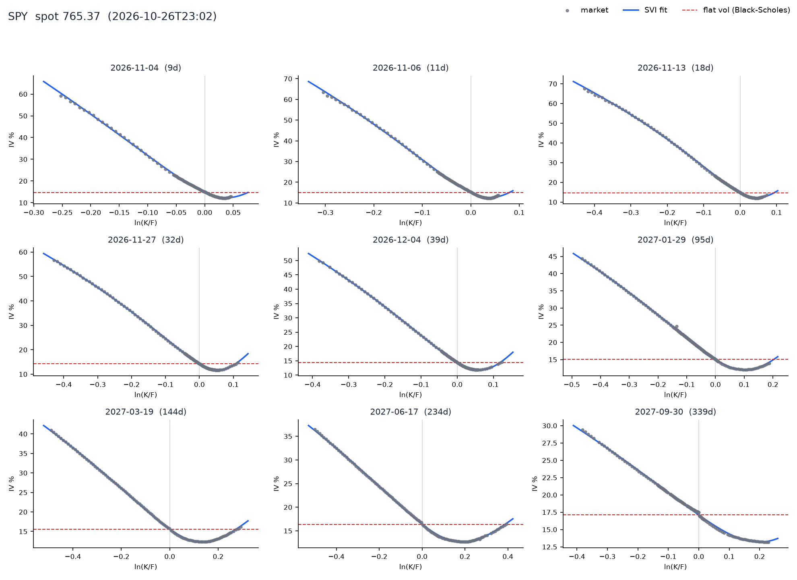
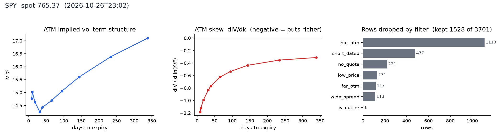
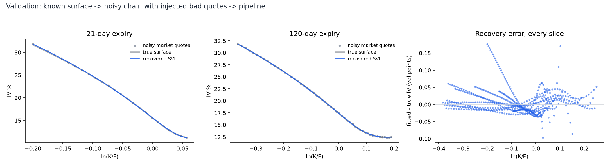
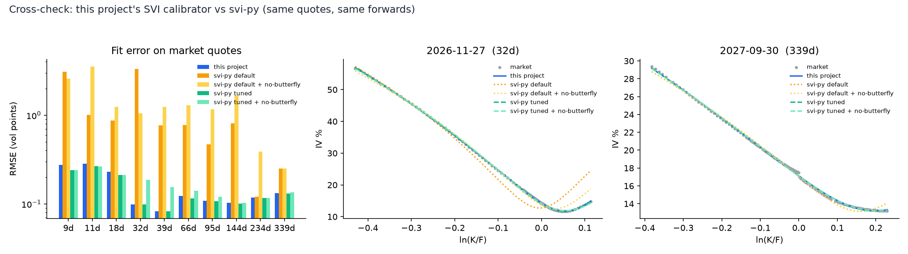

# Implied Volatility Surface Builder

Take a real options chain, work backwards from option prices to the volatility the market is pricing
at every strike and expiry, fit an arbitrage-aware surface, and plot it in 3D. Black-Scholes assumes
one flat volatility; the surface shows how wrong that is.



On a live SPY chain (26 Oct 2026, after the close) the at-the-money vol is ~15%, while far out-of-the-money
puts at the front of the curve price in ~60%. The red dashed line above is the flat vol Black-Scholes would use.

**Live demo:** https://jainamh029.github.io/iv-surface-builder/ &nbsp;|&nbsp; **[Interactive dashboard](https://jainamh029.github.io/iv-surface-builder/dashboard.html)**

The dashboard is a static page (no server, no build step) with a dark "Obsidian & Gold" theme and a light "Paper & Ink" theme.
* **Free-spin 3D** (Three.js): drag to rotate in any direction with momentum, scroll to zoom smoothly, Shift-drag to pan, double-click to reset.
  Also a Turntable mode that keeps the floor level, view presets, keyboard control (arrows, +/-, 0) and an idle auto-spin that you can pause
  (off by default when the OS asks for reduced motion). Hover reads any point; click queries it.
* **Surface and skew stages**: IV, total variance, local skew, variance slope or density, drawn with lighting, back-wall grids, a floor heat-shadow with contours and a colour legend.
* **Tenor bar**: click an expiry chip, step with the arrows, autoplay, or pin up to five tenors to overlay and compare.
* **Query tool**: click the surface or type a strike and maturity to get the implied vol, Black-76 price, delta and vega.
* **No-arbitrage views**: density g(k), calendar curves, a g(k) heatmap and minimum g per tenor; an **SVI sandbox** where you drag the parameters and watch arbitrage appear.
* **Data and audit**: filter breakdown, per-tenor fit table, svi-py comparison, CSV export of the surface grid, parameters and quotes.

All surface maths is re-implemented client-side in JavaScript from the exported SVI parameters; the query tool was checked against the Python library to the printed precision.

| | |
|---|---|
| Contracts | 3,701 downloaded, 1,528 survive cleaning (every drop is logged with a reason) |
| Expiries fitted | 10, from 9 to 339 days |
| Fit error on market quotes | 0.16 vol points mean RMSE, 1.2 worst case |
| Static arbitrage | 0 butterfly and 0 calendar violations on the observed strikes |
| Validation | recovers a known SSVI surface to 0.18 vol points max (test-enforced) |
| Cross-check | matches [svi-py](https://pypi.org/project/svi-py/) to ~0.1 vol points when it is tuned (see below) |

## Quick start

```bash
python3 -m venv .venv && source .venv/bin/activate
pip install -e ".[dev]"

python -m ivsurface SPY                        # live chain from Yahoo Finance
python -m ivsurface --synthetic                # offline, known ground truth
python -m ivsurface --from-csv data/SPY_*.csv  # re-run a chain saved by an earlier live run
pytest                                         # 13 tests
```

Results land in `outputs/<name>/`: `surface.html` (interactive, self-contained), `smiles.png`, `summary.png`,
`quotes_clean.csv`, `quotes_audit.csv` (every raw row with its keep/drop reason), `svi_params.csv`, and
`surface.json` (reload with `IVSurface.from_json`). If the market is closed Yahoo often returns zero
bids/asks; add `--use-last` to fall back on last trades. For European-style options use `^SPX`.

## How it works

| Stage | Module | What it does |
|---|---|---|
| Fetch | [`data.py`](ivsurface/data.py) | yfinance chain; expiries picked log-spaced in time so the long end isn't empty |
| Clean | [`prep.py`](ivsurface/prep.py) | Filter cascade with a reason per dropped row: crossed, no quote, wide spread, tiny price, short-dated, far OTM, IV failure, Hampel IV outlier, thin slice |
| Forward | [`prep.py`](ivsurface/prep.py) | `F = K + (C-P)/DF` from near-the-money put-call parity, median over 10 strikes; reports the implied dividend yield as a sanity check |
| Invert | [`black.py`](ivsurface/black.py) | Black-76 on the forward, vectorised bisection. NaN where a price breaks static no-arbitrage bounds. Only OTM options are used (puts below F, calls above): most time value, least early-exercise contamination |
| Fit | [`svi.py`](ivsurface/svi.py) | Raw SVI per expiry via the Zeliade quasi-explicit reduction: for fixed `(m, sigma)` the rest is a small linear constrained least-squares problem. Inverse-variance weights from bid/ask width in vol units |
| Surface | [`surface.py`](ivsurface/surface.py) | Linear interpolation of total variance in T at fixed `ln(K/F)` |



### No-arbitrage handling
* `w >= 0` and Lee's wing bound `b(1+|rho|) <= 2`: linear constraints in the inner fit.
* **Calendar**: every slice must satisfy `w_T(k) >= w_{T-1}(k)`, imposed as linear constraints.
* **Butterfly**: checked with Gatheral's `g(k) >= 0`; if violated a constrained 5-parameter refit is tried,
  and accepted only if it does not materially worsen the fit.
* Checks cover the **observed strike range** (butterfly: +/-0.10 beyond it; calendar: the overlap of adjacent
  slices, +/-0.05). Beyond that the surface is extrapolation and the 3D grid masks it. I tried constraining
  against other slices' extrapolated wings; it distorted real fits, so I don't.

## Validation

A fit that matches the market proves little when the market is noisy. So the pipeline is also run on a chain
generated from a known arbitrage-free SSVI surface, with bid/ask noise, tick rounding and ~4% injected bad
quotes (one-sided, crossed, stale outliers). Everywhere data exists the recovered vols are within 0.18 vol
points of the truth, and `tests/test_pipeline.py` enforces a 1-point bound.



## Cross-check against svi-py

[svi-py](https://pypi.org/project/svi-py/) (import name `pysvi`) is run on exactly the same cleaned quotes and
forwards. Fit quality, butterfly and calendar checks are computed by
[`scripts/crosscheck_svi_py.py`](scripts/crosscheck_svi_py.py), independent of either library.

| Calibrator | Mean RMSE (vol pts) | Worst error | Slices w/ butterfly arb | Calendar violations | Curve gap vs mine |
|---|---|---|---|---|---|
| **this project** | **0.16** | 1.21 | 0 | 0 | - |
| svi-py default | 1.15 | 9.80 | 6 | 45 | 1.04 |
| svi-py default + no-butterfly | 1.45 | 8.37 | 0 | 23 | 1.27 |
| svi-py tuned | 0.15 | 1.04 | 0 | 1 | 0.06 |
| svi-py tuned + no-butterfly | 0.17 | 1.02 | 0 | 0 | 0.11 |



**Reading it fairly.** svi-py's default minimises unweighted *total-variance* error, which neglects the
at-the-money region, so in vol terms it is ~7x worse. "Tuned" means its own `objective="implied_vol"` with
`initialization="multi_start"`. Tuned, the two independent calibrators agree to about a tenth of a vol point,
which is the real result. Differences: this project enforces calendar spreads by construction, and is ~15-20x
faster than svi-py's tuned configuration (~0.09 s vs 1.5-2 s per slice; svi-py's untuned default is faster at
~0.01 s but is the inaccurate one). Timings are one machine, one run.

svi-py needs Python >= 3.13, so the script runs from its own environment:

```bash
uv venv --python 3.13 .venv-xcheck
uv pip install --python .venv-xcheck/bin/python svi-py pandas matplotlib
.venv-xcheck/bin/python scripts/crosscheck_svi_py.py outputs/SPY
```

## Rebuild the report and dashboard

```bash
python -m ivsurface SPY                      # fetch + fit (writes data/ and outputs/SPY)
# optional: the svi-py cross-check above
python scripts/build_site.py outputs/SPY     # writes docs/: report, dashboard, JSON data, bundled Plotly.js
python -m http.server -d docs                # preview at http://localhost:8000 (fetch() needs HTTP, not file://)
```

`docs/` is fully static: no build step and no CDN (Plotly.js is bundled in `docs/assets`). To host it, set
**Settings -> Pages -> Deploy from a branch -> `main` / `/docs`**.

## Project layout

```
ivsurface/      black.py  data.py  synthetic.py  prep.py  svi.py  surface.py  plots.py  cli.py
scripts/        crosscheck_svi_py.py   build_site.py
tests/          13 tests: pricing, SVI recovery, constraints, end-to-end on a known surface
docs/           static site: index.html (report), dashboard.html (interactive), data/*.json, assets/
data/           raw chains saved by live runs (git-ignored: Yahoo data is not redistributed here)
```

## Limitations
* SPY/QQQ options are **American**; Black-76 treats them as European. Using OTM options limits the error, but
  a European-style index (`^SPX`) is the clean choice. I have only run SPY.
* The rate is a flat constant (`--rate`, default 4%), used only for discounting; the forward comes from parity.
* Yahoo data is free-grade and this snapshot is post-close; quote quality is usually the limiting factor.
  The repo ships the fitted results and cleaned implied vols for illustration, not the raw downloaded chain.
* SVI `rho`/`m` are weakly identified when one wing has no quotes (the fit is still good in-sample).
* No extrapolation past observed strikes (masked) or past the last expiry (`ValueError`).

## Third-party assets (shipped in `docs/assets`)
Three.js r160 (MIT), Plotly.js (MIT), Fira Sans and Fira Code (SIL OFL 1.1). Licenses are alongside the files. Three.js and the fonts were
installed from npm at pinned versions and checked against the registry's SHA-512 integrity hashes.

## References
* Gatheral, *A parsimonious arbitrage-free implied volatility parameterization* (SVI) and Gatheral & Jacquier,
  *Arbitrage-free SVI volatility surfaces*.
* Zeliade Systems, *Quasi-explicit calibration of Gatheral's SVI model*.
* Lee, *The moment formula for implied volatility at extreme strikes*.
* Related work: [garch-vol-surface](https://github.com/mvxddd/garch-vol-surface) (Black-76 on parity forwards,
  raw-SVI under constraints, quote diagnostics) and Naranjo's [SPX IV surface tutorial](https://lorenzonaranjo.com/blog/posts/spx-iv-surface.html).
